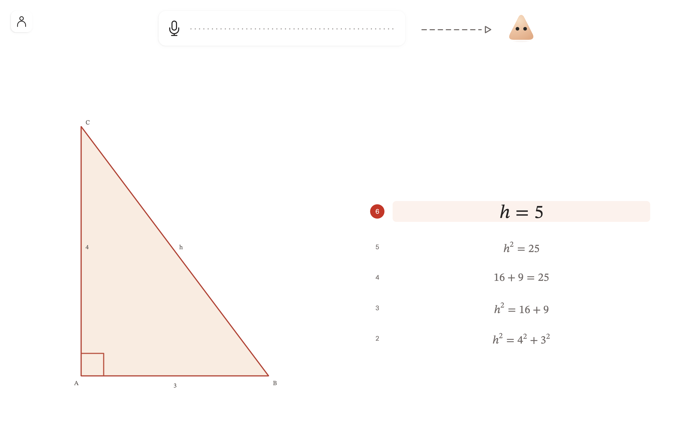

<p align="center">
  
</p>

# Mathwave

Mathwave makes math accessible through voice. It helps students with handwriting or reading difficulties enjoy and share math through equations, graphs, and diagrams.

[Try Mathwave](https://mathwave.app)



## Project layout

- **Web/** — React web app, mathematical engines, voice interaction, and server routes. Built with Vite through Vinext.
- **Native/** — Swift app and local speech and language models.
- **Training/** — Speech and language model training tools and datasets.
- **Evals/** — Evaluation tools, fixtures, and historical results.

## Run the web app locally

Use Node.js 22.13 or later and pnpm 11.25.0 (pinned in `package.json`).

```sh
pnpm install --frozen-lockfile
cp Web/.env.example Web/.env
pnpm run dev
```

Set the server credentials described in `Web/.env.example` to use cloud accounts and AI services. Keep real credentials in ignored environment files.

For local development without signing in, set `CLOUD_TEST_MODE=true` in `Web/.env`. This mode works only on localhost. Saving still requires a database connection, and AI features require a provider key.

## Verify the web app

```sh
pnpm run verify
```

This checks module boundaries, unit tests, TypeScript, lint, and the production build. Live voice, provider evaluations, and native app checks are separate workflows.

The native model files use Git LFS. Run `git lfs install` and `git lfs pull` after cloning to download them.
