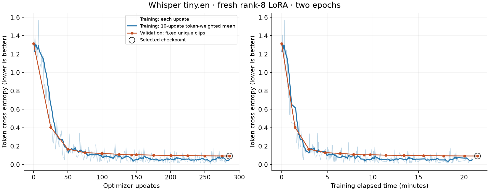
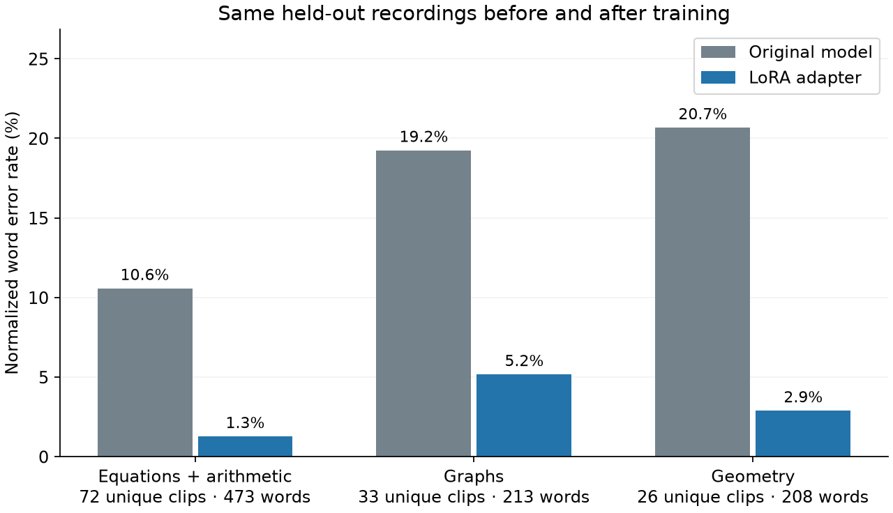

# Whisper tiny.en speech LoRA v2

Same frozen test: **14.53% → 2.74% normalized WER**, 154 → 29 edits over 1060 canonical reference tokens, 156 unique transcripts. Exact transcripts: 77 → 131. Raw whitespace WER: 36.93% → 4.36%.

| Category | Unique clips | Reference tokens | Before WER | After WER |
| --- | ---: | ---: | ---: | ---: |
| algebra | 72 | 473 | 10.57% | 1.27% |
| cross-topic | 8 | 68 | 7.35% | 2.94% |
| geometry | 26 | 208 | 20.67% | 2.88% |
| graphs | 33 | 213 | 19.25% | 5.16% |
| history-and-diagrams | 7 | 34 | 20.59% | 8.82% |
| statistics | 10 | 64 | 12.50% | 1.56% |

Arithmetic alone: 2 conversations, 9 unique clips; 17.86% → 1.79% WER. This tiny subset does not establish broad arithmetic accuracy.

## Training

PyTorch + Apple MPS, Hugging Face Transformers/PEFT. Original pinned Whisper tiny.en plus fresh rank-8 LoRA; no full fine-tuning. 147,456/37,907,712 parameters train. Two epochs, 1,140 training recordings, 2,280 example presentations, 286 optimizer updates. Selected update 286 using validation loss only. Validation CE: 1.312667 → 0.092125. Fourteen validation observations include baseline; training loss is logged at every update.

Training elapsed: 21.49 minutes, including periodic validation and adapter saves. Total experiment after ML imports: 26.94 minutes. Paid compute/API cost: $0. Frozen base hashes match; a fresh-process adapter reload exactly reproduces a fixed validation prediction.

## Split and provenance

500 conversations /1,615 recordings, six synthetic voices. Assigned conversations: 400 train /50 validation /50 test. Primary equations/arithmetic:160/20/20; graphs and geometry:80/10/10 each. Secondary arithmetic balancing:12/1/2 conversations. Retained clips after duplicate exclusions:1,140/150/163; unique transcripts:1,085/148/156. Related full program sequences and the24 parallel/transversal cases stay grouped. Exact transcript/waveform overlap is removed from lower-priority STT partitions.

The same fixed split, greedy decoder and normalizer are used before and after. No test score chooses checkpoints. V2 repartitions previously examined synthetic cases; this is not a new unseen or held-out-speaker benchmark. V1 evidence remains unchanged.

The experiment started under Evals. [Original source](provenance/source), [exact split used](provenance/frozen-split-used-for-training.json), and original report hashes are preserved. [Reorganization audit](reorganization-audit.json) proves the relocated rerun manifest has identical assignments, clips, groups, representatives, summaries, exclusions and normalization. Its metadata hashes differ only because the splitter moved. The stopped initial run is retained in provenance/notes/superseded-incomplete-run; it was stopped because the split had no arithmetic test cases, without inspecting test scores.

## Timing and limits

The original sequential test pass averaged 0.291s before and 0.770s after, with uncontrolled thermal/order differences. A separate warm interleaved validation probe (12 fixed clips,24 generations per condition, same loaded model, base adapters disabled vs enabled) averaged 0.744s base vs 0.820s adapter; medians 0.511s vs 0.613s. Different output lengths and adapter-toggle overhead remain. Neither probe establishes iPhone, microphone or end-to-end app latency. No speed improvement is claimed.

Number normalization canonicalizes cardinals, decimals and explicit operators, without evaluating expressions or erasing wrong signs/values. Original natural transcripts remain training targets. WER is transcription edit rate, not successful tool use.

All100 new conversations were independently reviewed. Authored shared-engine math replay remains497/500, with three documented pre-existing hyphenated-number parsing regressions. No product parser change, iPhone integration, LLM training, human-student evaluation or new app-rendering acceptance is claimed. Prior visual review remains2/400 v1 conversations.

Verification:28 relocated training tests +8 legacy speech tests pass; all1,615 WAVs and partition overlaps audited; plots visually inspected; original source/split hashes and unchanged base verified. Full web verify passed609 tests (5 skipped) before concurrent Web UI changes; that other chat owns subsequent Web verification.
